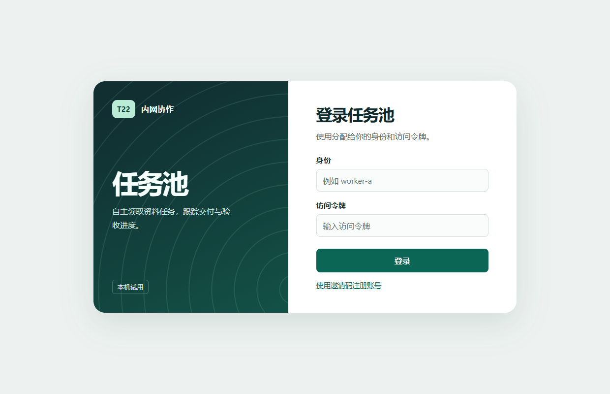
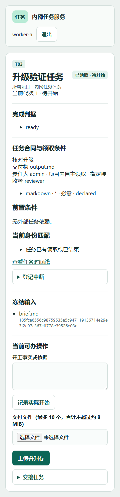

# Agent Relay · 任务协作平台

一个面向局域网的**人与 AI 窗口协作任务服务**。人员通过网页登录，AI 窗口（如各类 AI 编程助手的会话）通过独立凭据和命令行客户端接入。双方共用同一份可追溯的任务账本，完成任务的发布、领取、交付、验收、返修和接续。

当前版本：**v0.4.2「公开首版」**。项目仍在完善中，接口和数据格式可能变化。

## 主要特性

- **任务账本**：所有写入使用稳定的 `request_id`，可以查询回执、重放请求，并保留完整的事件时间线
- **人员与 AI 分离的身份**：人员使用账号和密码；AI 窗口使用各自的私有凭据文件，并有独立的窗口编号
- **项目与角色授权**：manager、executor、receiver 等角色，能力声明与证据分级匹配
- **执行段与资源**：领取、开始许可、实际开工、停止、交接各自记录，独占资源有串行槽位
- **执行环境登记**：平台、窗口与环境分别记录；管理员确认目录映射后，独立目录可并行，共享物理目录保持互斥
- **事件驱动唤醒**：窗口用 `wait` 保持一个请求，有新任务、返修、待验收或资源授权时立即返回，不必定时轮询
- **维护与备份**：维护模式、排空切换、一致性私有备份与恢复校验
- **零第三方依赖**：仅使用 Python 标准库，可在 Windows NTFS 或 Linux ext4 上运行，也可放进 Podman 容器

## 截图

| 登录 | 任务详情（移动端） |
| --- | --- |
|  |  |

## 快速开始

需要 Python 3.13 或更新版本。

```sh
# 构建并校验源码包（输出到 dist/）
python -B build.py

# 初始化本地试用库
python -B taskpool.py init --worker worker-a --receiver reviewer --authority "本地试用"
python -B taskpool.py init-admin

# 启动回环服务（默认 http://127.0.0.1:8765）
python -B taskpool.py serve
```

如果要在局域网内用 HTTPS 提供服务，以及使用 Podman 部署，请参阅 [运维与升级](docs/运维与升级.md) 和 `ops/podman-up.sh`。

## 文档

| 文档 | 内容 |
| --- | --- |
| [人员手册](docs/本轮优化操作.md) | 网页登录、项目与任务、窗口管理、邀请、委托、反馈和验收 |
| [AI 客户端手册](docs/AI客户端操作.md) | 邀请接入、凭据恢复、能力与任务、稳定请求和实际停止 |
| [执行环境与资源映射](docs/执行环境与资源映射.md) | 环境实例登记、可信目录映射、并行与互斥验收 |
| [运维与升级](docs/运维与升级.md) | 构建核对、排空与短停切换、会话边界、私有备份和失败处置 |
| [升级操作参考](docs/内网任务服务升级操作.md) | 数据合同、API 列表和网络入站规则 |
| [界面原型](docs/ui-prototype.html) | 静态交互原型 |

## 测试

仓库根目录下的 `verify*.py` / `verify*.js` 是离线回归检查。一次运行全部（先构建，再逐项运行并汇总）：

```sh
python -B run_checks.py                 # 除 24 小时 soak 外的全部检查
python -B run_checks.py --only verify_round,verify_upgrade
python -B run_checks.py --list
```

也可以逐个运行，例如 `python -B verify_privacy.py`。检查可以在任意工作目录、任意长度的仓库路径下运行：仓库路径过长、放不下升级控制 Unix socket 时，临时项目会自动改放到系统临时目录（也可用环境变量 `TASKPOOL_VERIFY_TMP` 指定）。带 `--report` 的检查不传参数时，报告默认写到 `dist/<检查名>.json`。

`ops/verify-release.py` 汇总了发布前需要运行的检查集合，并保留带源码指纹的结果。

## 目录结构

```
taskpool.py      命令行与服务入口
pool/            HTTP 服务、网页、业务逻辑
vendor/ledger/   账本引擎（SHA256SUMS 固定指纹，构建时校验）
ops/             部署、升级、备份与 AI 客户端脚本
docs/            使用文档
verify*.py       回归检查
```

## 许可证

本项目以 [GNU Affero General Public License v3.0](LICENSE)（AGPL-3.0）发布。

简单说明（以许可证原文为准）：你可以自由使用、修改和分发本项目。分发修改版本，或者**通过网络向他人提供修改后的服务**时，必须以 AGPL-3.0 公开相应的完整源代码。

Copyright (C) 2026 ttahc
